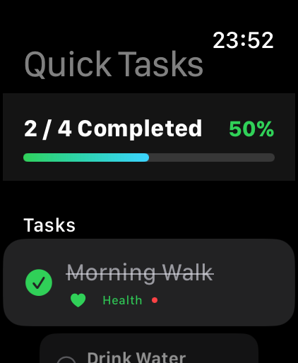
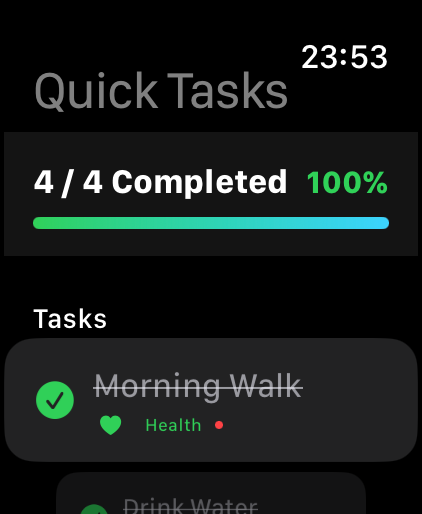
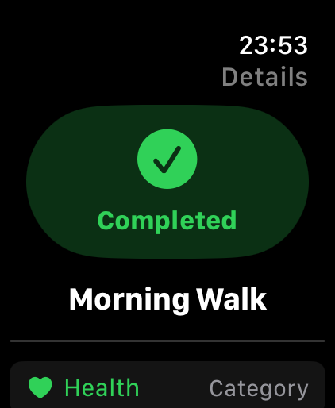

# SE4041 – Practical 05: Quick Tasks (watchOS)

**Student:** kalaiyalagan Thiveesan (IT23204348)
**Module:** SE4041 – Mobile Application Design & Development
**Platform:** watchOS 9+ · SwiftUI · Swift

A Watch-only app to quickly view and complete daily tasks from the Apple Watch.

## Features

- `TaskItem` model conforming to `Identifiable` (`id`, `title`, `completed`)
- Four initial tasks stored with `@State`
- Main screen inside `NavigationStack` with a `List` and SF Symbols
- Tap a task to toggle completion with `.toggle()` (`circle` ↔ `checkmark.circle.fill`)
- Live completion count (`2 / 4 Completed`) calculated with `filter`
- Separate **Details** section using `NavigationLink` → `TaskDetailView` (title, status, symbol)
- **Additional feature – Option A: Reset Tasks** (marks every task incomplete)

## Project Structure

```text
QuickTasks/
├── QuickTasksApp.swift     # @main entry point
├── ContentView.swift       # Main screen: count, toggle list, details, reset
├── TaskItem.swift          # Model
└── TaskDetailView.swift    # Detail screen
```

## Run

1. Open `QuickTasks.xcodeproj` in Xcode 15+.
2. Select the watch app scheme and an Apple Watch Simulator.
3. Press **⌘R**.

## Testing

| # | Test | Result |
|---|------|--------|
| 1 | All four tasks appear on launch | ✅ |
| 2 | Tapping an incomplete task marks it completed | ✅ |
| 3 | Tapping it again marks it incomplete | ✅ |
| 4 | Completion count updates | ✅ |
| 5 | Detail screen shows correct, updated info | ✅ |
| 6 | Tested on two simulator sizes | ✅ |

## Screenshots




